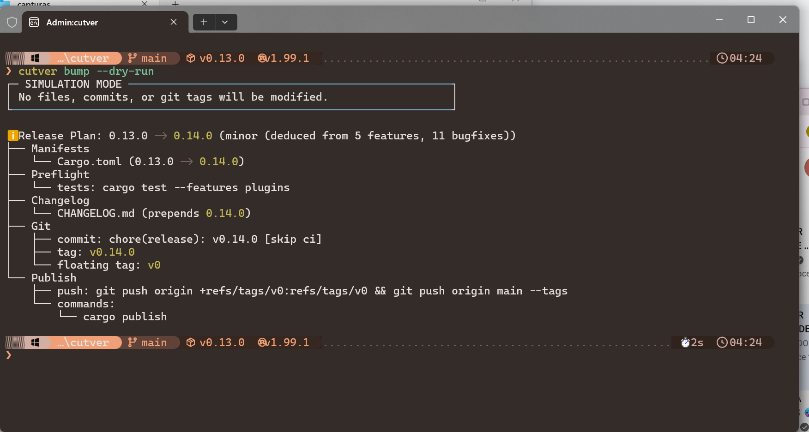
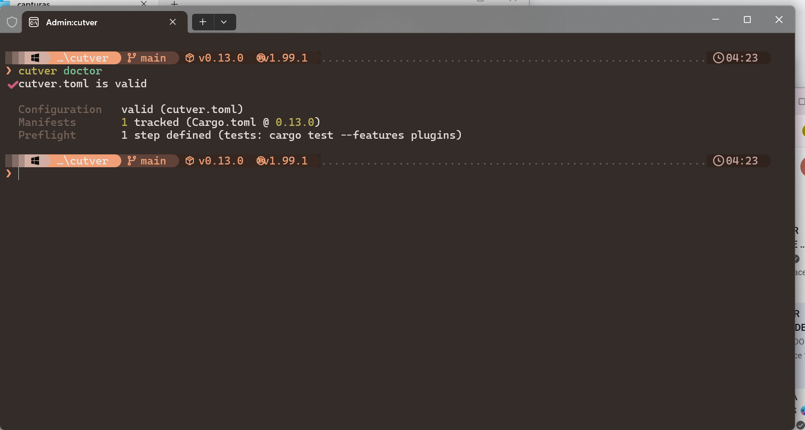
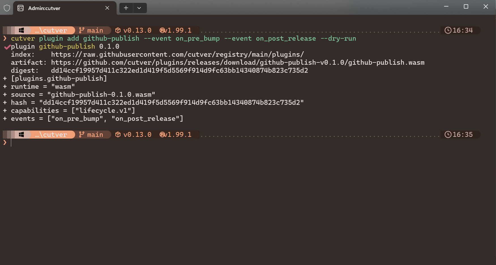
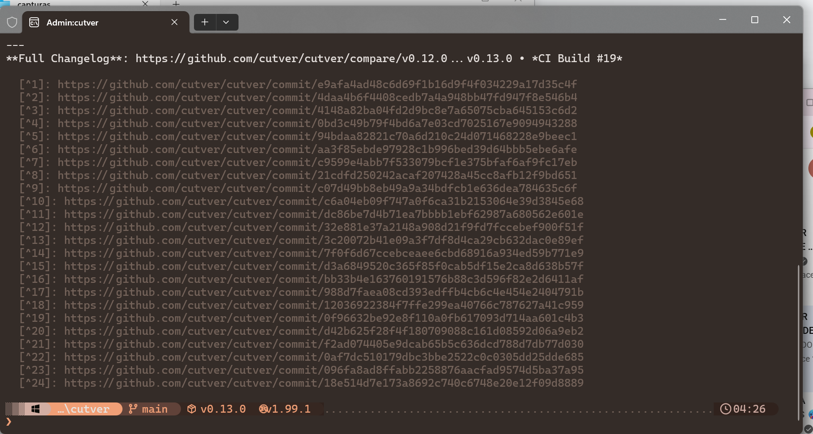
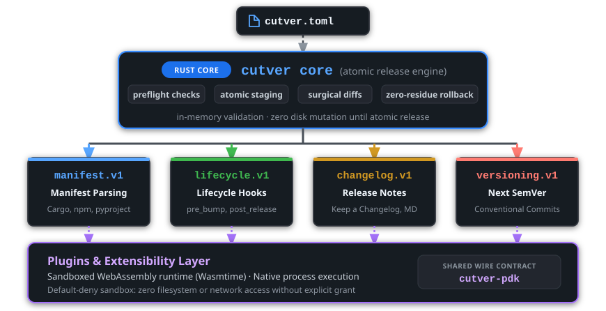

<div align="center">

<picture>
  <source media="(prefers-color-scheme: dark)" srcset="assets/cutver-mark-dark.svg">
  <source media="(prefers-color-scheme: light)" srcset="assets/cutver-mark-light.svg">
  
</picture>

# cutver

**A release engine you can extend: one core, four typed capability slots, and plugins that run sandboxed by default.**

> *Cut a release. Bump SemVer. Every project, every language.*

[](https://github.com/cutver/cutver/actions/workflows/ci.yml)
[](https://github.com/cutver/cutver/actions/workflows/release.yml)
[](https://github.com/cutver/cutver/releases)
[](https://github.com/cutver/cutver)
[](https://github.com/cutver/cutver/releases)
[](https://crates.io/crates/cutver)
[](LICENSE)

<br/>

<p align="center">
  <a href="#-the-30-second-path">Quickstart</a> •
  <a href="#-visual-gallery">Gallery</a> •
  <a href="#-installation">Install</a> •
  <a href="#-architecture--capabilities">Architecture</a> •
  <a href="#-plugins-first-class">Plugins</a> •
  <a href="#-supported-manifests">Manifests</a> •
  <a href="#-official-insignia">Badge</a> •
  <a href="#-github-actions">CI/CD</a> •
  <a href="#-ai-coding-skills">AI Skills</a> •
  <a href="#-frequently-asked-questions">FAQ</a> •
  <a href="#-documentation">Docs</a>
</p>

<br/>

<p align="center">
  
</p>

</div>

---

## Overview

`cutver` is a standalone, language-agnostic release orchestration engine written in **Rust**. It synchronizes versions across your manifests, runs your preflight checks, renders the changelog, commits, tags, and publishes — driven by one declarative `cutver.toml`. It versions itself, tests itself, generates its own changelogs, and publishes itself.

What separates it from a simple version-bumping script: **four stages are typed capability slots**. The core orchestrates; the behavior is pluggable.

---

## 🖼️ Visual Gallery

See Cutver in action across the release lifecycle:

<div align="center">

| Preflight Diagnostics (`cutver doctor`) | Atomic Bump Simulation (`cutver bump --dry-run`) |
| :---: | :---: |
|  |  |

| WebAssembly Plugin Engine (`cutver plugin add`) | Formatted Release Notes (`cutver changelog latest`) |
| :---: | :---: |
|  |  |

</div>

---

## ⚡ The 30-Second Path

```bash
cutver init                  # Discover manifests, scaffold cutver.toml
cutver doctor                # Validate config, manifests, and version drift
cutver bump auto --dry-run   # Simulate the entire release without touching disk
cutver bump auto             # Compute in memory, apply atomically
```

### Essential Commands

| Command | Action | Key Flags |
| :--- | :--- | :--- |
| <kbd>cutver init</kbd> | Scaffolds `cutver.toml` from detected manifests | `--update`, `--force`, `--no-template` |
| <kbd>cutver doctor</kbd> | Validates manifest sync, changelog drift, and config | `--check-changelog` |
| <kbd>cutver bump</kbd> | Executes atomic version bumps and Git tagging | `auto`, `patch`, `minor`, `major`, `--dry-run`, `--first-release` |
| <kbd>cutver changelog</kbd> | Queries entries or extracts release notes | `latest`, `show <version>`, `--notes-file` |
| <kbd>cutver plugin</kbd> | Manages sandboxed WebAssembly plugins | `add <name>`, `list`, `remove <name>` |

Every mutating command validates in memory first and then applies **atomically**. Comments, key order, and formatting survive the diff, and a failure before the release commit rolls the workspace back cleanly rather than leaving it half-mutated. Once the release commit succeeds, the tag and publish steps execute deterministically.

---

## 📦 Installation

Choose the build that fits your workflow:
- **Recommended: `cutver-plugins` (~5 MB):** Adds the full WebAssembly plugin runtime (`cutver plugin add/remove/list`).
- **Lean build: `cutver` (~1.25 MB):** Standalone core engine for minimal, zero-overhead CI runners.

<details open>
<summary><b>🪟 Windows (Scoop)</b></summary>

```bash
scoop bucket add row https://github.com/Row0902/scoop-bucket

# Pick one:
scoop install cutver            # Lean (~1.25 MB)
scoop install cutver-plugins    # Plugin runtime (~5 MB)
```

</details>

<details>
<summary><b>🍎 macOS & 🐧 Linux (Homebrew)</b></summary>

```bash
# Pick one:
brew install Row0902/tap/cutver            # Lean (~1.25 MB)
brew install Row0902/tap/cutver-plugins    # Plugin runtime (~5 MB)
```

</details>

<details>
<summary><b>🦀 Rust Cargo</b></summary>

```bash
# Lean build
cargo install cutver

# With WebAssembly plugin runtime
cargo install cutver --features plugins
```

</details>

<details>
<summary><b>🐳 OCI Containers (Docker / Podman)</b></summary>

```bash
# Lean image
docker pull ghcr.io/cutver/cutver:latest

# With plugin runtime
docker pull ghcr.io/cutver/cutver:plugins
```

</details>

---

## 🏛️ Architecture & Capabilities

<p align="center">
  <picture>
    <source media="(prefers-color-scheme: dark)" srcset="assets/architecture-dark.svg">
    <source media="(prefers-color-scheme: light)" srcset="assets/architecture-light.svg">
    
  </picture>
</p>

| Capability | What a plugin takes over |
| :--- | :--- |
| `manifest.v1` | Read and write a manifest format the core does not know. |
| `lifecycle.v1` | Run on `on_pre_bump`, `on_post_bump`, and `on_post_release`. |
| `changelog.v1` | Render the release notes. |
| `versioning.v1` | Decide the next version from your commits. |

The core ships its own implementation of every slot, so nothing is required to cut a release. Plugins replace or extend a stage when your project needs it. A plugin is a **sandboxed WebAssembly module** or a native process, and both speak the same versioned contract ([`cutver-pdk`](https://crates.io/crates/cutver-pdk)).

---

## 🧩 Plugins, First-Class

```bash
cutver plugin add github-releases    # Resolve, download, verify SHA-256, configure
cutver plugin list                   # Declared vs installed vs digest-matched
cutver plugin remove github-releases # Surgical removal, artifact included
```

`add` reads the [Cutver registry](https://github.com/cutver/registry), downloads the release artifact, verifies its **SHA-256 before the file enters the cache**, and writes the declaration into `cutver.toml`. From then on, the loader re-verifies that digest on **every single load**.

```toml
[plugins.github-releases]
runtime = "wasm"
source = "github-releases-0.1.0.wasm"
hash = "a828cbabd247afdaf78fec358ae5a27271097c7c2ef6fc9ec0fe04af22edf841"
capabilities = ["changelog.v1"]
```

> **Security Guarantee:** A WASM plugin gets **no filesystem, no network, and no environment** access unless explicitly granted under `[plugins.<name>.permissions]`. There is no `--insecure` bypass.

---

## 📑 Supported Manifests

Each format has its own format-preserving editor designed to maintain comments, whitespace, and key ordering:

| Ecosystem | Manifest File | Kind in `cutver.toml` | Diff Guarantee |
| :--- | :--- | :--- | :--- |
| **Rust** | `Cargo.toml` | `cargo-package` | Preserves comments, whitespace, and table order |
| **Typst** | `typst.toml` | `toml` | Format-preserving AST editor |
| **JavaScript / Node** | `package.json` | `json` | Byte-span in-place version editing |
| **Python** | `pyproject.toml` | `pyproject` / `toml` | Format-preserving TOML AST editor |
| **Java / Kotlin** | `build.gradle` / `.kts` | `gradle` | Increments version and `versionCode` |
| **Arbitrary Text** | `VERSION`, `README.md` | `regex` | Targeted capture-group replacement |
| **Custom Ecosystem** | *Any file* | `plugin` | Delegated to a `manifest.v1` WASM plugin |

---

## 🏷️ Official Insignia

Show that your project's releases are deterministic, preflight-audited, and automated with Cutver:

<div align="center">

[](https://github.com/cutver/cutver)

</div>

<details>
<summary><b>📋 Copy Badge Snippets (Markdown &amp; HTML)</b></summary>

#### Markdown
```markdown
[](https://github.com/cutver/cutver)
```

#### HTML
```html
<a href="https://github.com/cutver/cutver"></a>
```

</details>

---

## 🤖 GitHub Actions Integration

Automate releases securely in CI/CD using official GitHub Actions and `@cutver-release[bot]`:

<details>
<summary><b>📄 Production Release Workflow (<code>.github/workflows/release.yml</code>)</b></summary>

```yaml
name: Release

on:
  workflow_dispatch:
    inputs:
      first_release:
        description: "First release (tag current version without bumping)"
        required: false
        default: false
        type: boolean
      bump:
        description: "Release bump level"
        required: true
        default: "auto"
        type: choice
        options: [auto, patch, minor, major]
      dry_run:
        description: "Simulate release"
        required: false
        default: false
        type: boolean

permissions:
  contents: write
  pull-requests: write

jobs:
  release:
    runs-on: ubuntu-latest
    steps:
      - name: Generate Token for cutver-release[bot]
        id: release-token
        uses: actions/create-github-app-token@v3
        with:
          app-id: ${{ secrets.CUTVER_APP_ID }}
          private-key: ${{ secrets.CUTVER_APP_PRIVATE_KEY }}

      - name: Checkout repository
        uses: actions/checkout@v4
        with:
          fetch-depth: 0
          token: ${{ steps.release-token.outputs.token }}

      - name: Setup Git credentials
        run: |
          git config --global user.name "cutver-release[bot]"
          git config --global user.email "${{ steps.release-token.outputs.app-slug }}[bot]@users.noreply.github.com"

      - name: Install Cutver CLI
        uses: cutver/setup@v1

      - name: Execute Cutver Release
        uses: cutver/release@v1
        id: cutver
        env:
          GH_TOKEN: ${{ steps.release-token.outputs.token }}
        with:
          command: release
          bump: ${{ github.event.inputs.bump }}
          first-release: ${{ github.event.inputs.first_release }}
          dry-run: ${{ github.event.inputs.dry_run }}

      - name: Publish GitHub Release
        if: steps.cutver.outputs.released == 'true' && !github.event.inputs.dry_run
        env:
          GH_TOKEN: ${{ steps.release-token.outputs.token }}
        run: |
          gh release create "${{ steps.cutver.outputs.tag }}" \
            --title "${{ steps.cutver.outputs.tag }}" \
            --notes-file "${{ steps.cutver.outputs.notes-path }}"
```

</details>

---

## 🧠 AI Coding Skills

Equip coding assistants (Pi, Claude Code, Cursor, Copilot, Eve) with release skills from [Cutver Agent Skills](https://github.com/cutver/skills):

```bash
npx skills add cutver/skills
# or
pnpm dlx skills add cutver/skills
# or
bunx skills add cutver/skills
```

Includes **8 autonomous skills**:
- `cutver-release`: Execute safe semantic version bumps with mandatory dry-run simulation.
- `cutver-doctor`: Validate manifest synchronization, changelog alignment, and detect drift.
- `cutver-init`: Auto-discover manifests and scaffold canonical `cutver.toml`.
- `cutver-actions`: Scaffold and configure GitHub Actions release workflows.
- `cutver-changelog`: Extract release notes and render MiniJinja templates.
- `cutver-containers`: Run Cutver inside Docker, Podman, or WSL containers.
- `cutver-install`: Environment detection and package manager setup.
- `cutver-open`: Instant navigation to docs, releases, and changelogs.

---

## ❓ Frequently Asked Questions

<details>
<summary><b>How does Cutver differ from tools like <code>semantic-release</code>, <code>changesets</code>, or <code>cargo-release</code>?</b></summary>
<br/>

Cutver is a standalone, language-agnostic release engine written in Rust. Unlike ecosystem-specific tools (`cargo-release` for Rust, `changesets` for npm), Cutver operates across any combination of ecosystems simultaneously (Cargo, npm, PyPI, Gradle, arbitrary text). Unlike Node-heavy orchestrators (`semantic-release`), Cutver requires zero node runtime or dependencies, executes in milliseconds, provides a guaranteed zero-residue rollback on preflight failure, and exposes four typed capability slots extended through sandboxed WebAssembly plugins.
</details>

<details>
<summary><b>What happens if a preflight check, hook, or commit fails halfway through?</b></summary>
<br/>

Cutver uses a strict **two-phase atomic execution model**:
1. **Phase 1 (In-Memory Validation):** Computes new versions, parses commits, checks changelog drift, runs preflight verification, and dry-runs every mutation in memory.
2. **Phase 2 (Atomic Apply):** Commits, tags, and runs post-hooks only once all validations pass.

If a failure occurs during preflights or staging, Cutver immediately aborts without touching disk, leaving no uncommitted diffs, no partial manifest bumps, and no orphaned Git tags.
</details>

<details>
<summary><b>Do I need WebAssembly / Wasmtime if I only want minimal CI bumps?</b></summary>
<br/>

No. Cutver provides two distinct builds:
- **`cutver` (Lean build, ~1.25 MB):** Standalone zero-overhead static binary containing the complete core engine (manifest parsing, SemVer deduction, atomic apply, preflight checks, changelog rendering). Perfect for lean, minimal CI/CD runners.
- **`cutver-plugins` (~5 MB):** Adds the full sandboxed WebAssembly plugin engine (`Wasmtime`) for projects leveraging custom plugins.
</details>

<details>
<summary><b>Are third-party WebAssembly plugins secure? Can they access my filesystem or secrets?</b></summary>
<br/>

Cutver enforces a strict **default-deny capability model**:
- Every WASM plugin runs isolated within Wasmtime with **zero filesystem, zero network, and zero environment access** by default.
- Permissions must be explicitly declared and granted in `cutver.toml` under `[plugins.<name>.permissions]`.
- There is no `--insecure` CLI bypass. Furthermore, every downloaded plugin has its SHA-256 digest verified prior to caching and re-verified on every load.
</details>

<details>
<summary><b>How does Cutver preserve formatting, comments, and key ordering in manifests?</b></summary>
<br/>

Rather than re-serializing entire configuration files (which destroys comments and formatting), Cutver uses surgical, format-preserving AST editors (like `toml_edit` for TOML and byte-span targeted surgery for JSON and Gradle). Only the exact version fields are mutated; comments, whitespace, and existing key order survive the diff untouched.
</details>

---

## 📚 Documentation

| Category | Guide | Description |
| :--- | :--- | :--- |
| **Guides** | [Getting Started Walkthrough](docs/guides/getting-started.md) | Step-by-step first release workflow and core concepts. |
| | [Monorepos & Multi-Package Strategies](docs/guides/monorepos.md) | Coordinated releases across polyglot workspaces without drift. |
| **Reference** | [cutver.toml Configuration Reference](docs/reference/configuration.md) | Canonical reference for every table, preflight timeout, and hook. |
| | [Language Manifests & Diff Guarantees](docs/reference/manifests.md) | Format-preserving byte-span scanner and AST editor guarantees. |
| | [CLI Commands & Exit Codes](docs/reference/cli.md) | Comprehensive command options, flags, and exit codes. |
| | [Installing & Managing Plugins](docs/reference/plugins.md) | Install flow, digest verification, cache location, and the plugin commands. |
| **Templates** | [Customizing Release Templates](docs/templates/release-notes.md) | Variables, commit filters, breaking descriptions, and CI attribution. |
| **Integrations** | [GitHub Actions Integration Guide](docs/integrations/github-actions.md) | Official `cutver/setup` and `cutver/release` action workflows. |
| | [Container Integration Guide](docs/integrations/containers.md) | Running Cutver with Podman, Docker, `docker://`, and GitLab CI. |
| **Internals** | [Architecture & Design Decisions](docs/internals/design.md) | Two-phase release pipeline, atomic scanner, and design history. |
| | [Plugin Engine Architecture](docs/rfcs/0001-wasm-plugin-architecture.md) | The microkernel, the capability contract, and the two runtimes. |

---

## License

MIT © [Cutver Authors](https://github.com/cutver/cutver) & [Row0902](https://github.com/Row0902)

---

<div align="center">
  <sub>Built with Rust for deterministic releases and universal developer access.</sub>
</div>
