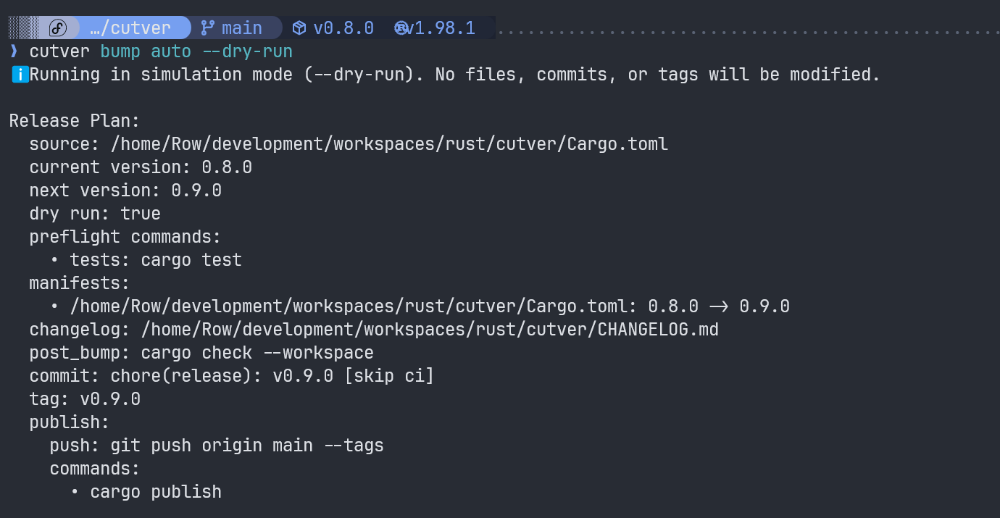

<div align="center">

# cutver

**A release engine you can extend: one core, four typed capability slots, and plugins that run
sandboxed by default.**

> *Cut a release. Bump SemVer. Every project, every language.*

[](https://github.com/cutver/cutver/actions/workflows/ci.yml)
[](https://github.com/cutver/cutver/actions/workflows/release.yml)
[](https://github.com/cutver/cutver/releases)
[](https://github.com/cutver/cutver/releases)
[](https://crates.io/crates/cutver)
[](LICENSE)

<br/>

<p align="center">
  
</p>

</div>

---

`cutver` is a standalone release orchestration engine written in pure Rust. It synchronizes versions
across your manifests, runs your preflight checks, renders the changelog, commits, tags and
publishes — driven by one declarative `cutver.toml`. It versions itself, tests itself, generates its
own changelogs and publishes itself.

What separates it from a version-bumping script: **four stages are typed capability slots**. The core
orchestrates; the behaviour is pluggable.

```text
                      cutver.toml
                           │
      ┌────────────────────┴────────────────────┐
      │               cutver core               │
      │   orchestration · preflights · SemVer   │
      │   atomic apply · surgical diffs         │
      └──┬──────────┬───────────┬───────────┬───┘
         │          │           │           │
   manifest.v1  lifecycle.v1  changelog.v1  versioning.v1
         │          │           │           │
      ┌──┴──────────┴───────────┴───────────┴───┐
      │ plugins: sandboxed WASM · native process │
      │ one versioned wire contract (cutver-pdk) │
      └──────────────────────────────────────────┘
```

| Capability | What a plugin takes over |
| :--- | :--- |
| `manifest.v1` | Read and write a manifest format the core does not know. |
| `lifecycle.v1` | Run on `pre_bump`, `post_bump` and `post_release`. |
| `changelog.v1` | Render the release notes. |
| `versioning.v1` | Decide the next version from your commits. |

The core ships its own implementation of every slot, so nothing is required to cut a release.
Plugins replace or extend a stage when your project needs it. A plugin is a sandboxed WebAssembly
module or a native process, and both speak the same versioned contract
([`cutver-pdk`](https://crates.io/crates/cutver-pdk)). A WASM plugin gets **no filesystem, no network
and no environment** unless you grant it under `[plugins.<name>.permissions]`.

## Install

> **Two builds — pick one.** Homebrew carries two formulae (`cutver`, `cutver-plugins`) and Scoop two
> manifests, both available for 0.13.0 and later. Both install a binary named `cutver`; the
> plugin-enabled build adds the WebAssembly plugin runtime (`cutver plugin add/remove/list`) at ~5 MB
> compressed, against ~1.25 MB lean.

```bash
# Homebrew (macOS & Linux) — pick one
brew install Row0902/tap/cutver            # lean (~1.25 MB)
brew install Row0902/tap/cutver-plugins    # plugin runtime (~5 MB)

# Scoop (Windows) — pick one
scoop bucket add row https://github.com/Row0902/scoop-bucket
scoop install cutver            # lean (~1.25 MB)
scoop install cutver-plugins    # plugin runtime (~5 MB)

# Cargo — add --features plugins for the plugin runtime
cargo install cutver

# OCI Container (Docker / Podman) — add :plugins for the plugin runtime
docker pull ghcr.io/cutver/cutver:latest
```

## The 30-Second Path

```bash
cutver init                  # discover manifests, scaffold cutver.toml
cutver doctor                # validate config, manifests and version drift
cutver bump auto --dry-run   # see the whole release without writing anything
cutver bump auto             # compute in memory, apply atomically
```

Every mutating command validates in memory first and then applies atomically. Comments, key order
and formatting survive the diff, and a failed step rolls the workspace back rather than leaving it
half-released.

## Plugins, First-Class

```bash
cutver plugin add github-releases    # resolve, download, verify, install, configure
cutver plugin list                   # declared vs installed vs digest-matched
cutver plugin remove github-releases # surgical removal, artifact included
```

`add` reads the [Cutver registry](https://github.com/cutver/registry), downloads the release
artifact, verifies its SHA-256 **before** the file enters the cache, and writes the declaration for
you. From then on the loader re-verifies that digest on **every** load. The install gate has no
bypass — there is no `--insecure` flag and no fallback to whatever the URL returned — and `add`
always writes the `hash` that the load gate checks.

```toml
[plugins.github-releases]
runtime = "wasm"
source = "github-releases-0.1.0.wasm"
hash = "a828cbabd247afdaf78fec358ae5a27271097c7c2ef6fc9ec0fe04af22edf841"
capabilities = ["changelog.v1"]
```

> **Gotcha**: a `changelog.v1` plugin is only dispatched when `[changelog] format = "plugin"`. With
> the default `keep-a-changelog`, the built-in renderer runs and the installed plugin stays idle.

Full detail in [Installing & Managing Plugins](docs/reference/plugins.md) and the
[plugin engine architecture](docs/rfcs/0001-wasm-plugin-architecture.md).

## Supported Manifests

Each format has its own editor, chosen for what it must preserve: comments, key order and whitespace
survive in `Cargo.toml` and `pyproject.toml`, JSON is touched only inside the version string's byte
span, and Gradle or any text file goes through a capture-group replacement — so the diff is the
version and nothing else. Precompiled Cosign-signed binaries cover 8 targets — Linux glibc and
musl on x86_64 and ARM64, macOS Intel and Apple Silicon, Windows x86_64 and ARM64 — plus
plugin-enabled variants of each, on the [releases page](https://github.com/cutver/cutver/releases).

[Language Manifests & Diff Guarantees](docs/reference/manifests.md) documents every kind and what it
preserves.

## Documentation

| Category | Guide | Description |
| :--- | :--- | :--- |
| **Guides** | [Getting Started Walkthrough](docs/guides/getting-started.md) | Step-by-step first release workflow and core concepts. |
| | [Monorepos & Multi-Package Strategies](docs/guides/monorepos.md) | Coordinated releases across polyglot workspaces without drift. |
| **Reference** | [cutver.toml Configuration Reference](docs/reference/configuration.md) | Canonical reference for every table, preflight timeout, and hook. |
| | [Language Manifests & Diff Guarantees](docs/reference/manifests.md) | Format-preserving byte-span scanner and AST editor guarantees. |
| | [CLI Commands & Exit Codes](docs/reference/cli.md) | Comprehensive command options, flags, and exit codes. |
| | [Installing & Managing Plugins](docs/reference/plugins.md) | Install flow, digest verification, cache location, and the plugin commands. |
| **Templates** | [Customizing Release Templates](docs/templates/release-notes.md) | Variables, commit filters, breaking descriptions, and CI attribution. |
| **Integrations** | [GitHub Actions Integration Guide](docs/integrations/github-actions.md) | Official `cutver/setup` and `cutver/release` action workflows. |
| | [Container Integration Guide](docs/integrations/containers.md) | Running cutver with Podman, Docker, `docker://`, and GitLab CI. |
| **Internals** | [Architecture & Design Decisions](docs/internals/design.md) | Two-phase release pipeline, atomic scanner, and design history. |
| | [Plugin Engine Architecture](docs/rfcs/0001-wasm-plugin-architecture.md) | The microkernel, the capability contract, and the two runtimes. |

---

## AI Coding Skills

Equip coding assistants (Pi, Claude Code, Cursor, GitHub Copilot) with release skills from [Cutver Agent Skills](https://github.com/cutver/skills):

```bash
npx skills add cutver/skills
```

Includes 8 autonomous skills covering releases (`cutver-release`), diagnostics (`cutver-doctor`), onboarding (`cutver-init`), changelogs (`cutver-changelog`), CI/CD workflows (`cutver-actions`), OCI containers (`cutver-containers`), installation (`cutver-install`), and navigation (`cutver-open`).

---

## License

MIT © [Cutver Authors](https://github.com/cutver/cutver) & [Row0902](https://github.com/Row0902)
