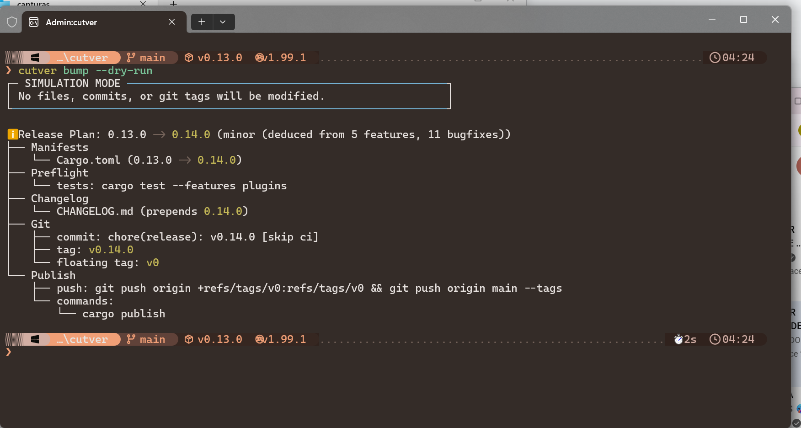
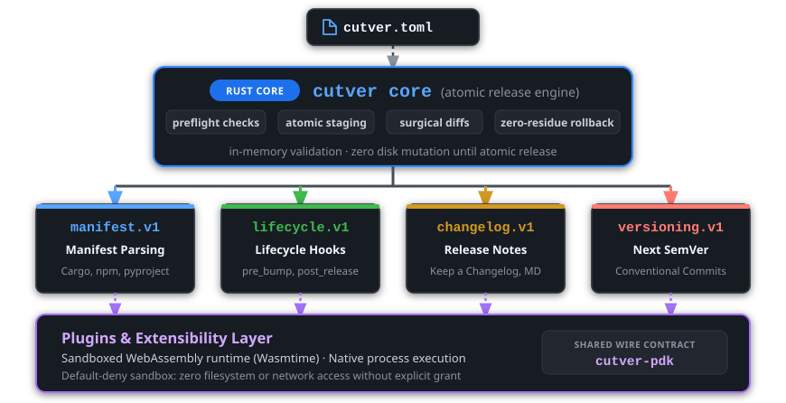

<div align="center">

<picture>
  <source media="(prefers-color-scheme: dark)" srcset="assets/cutver-mark-dark.svg">
  <source media="(prefers-color-scheme: light)" srcset="assets/cutver-mark-light.svg">
  
</picture>

# cutver

**A release engine you can extend: one core, four typed capability slots, and plugins that run sandboxed by default.**

> *Cut a release. Bump SemVer. Every project, every language.*

[](https://github.com/cutver/cutver/actions/workflows/ci.yml)
[](https://github.com/cutver/cutver/actions/workflows/release.yml)
[](https://github.com/cutver/cutver/releases)
[](https://github.com/cutver/cutver)
[](https://github.com/cutver/cutver/releases)
[](https://crates.io/crates/cutver)
[](LICENSE)

<br/>

<p align="center">
  <a href="#-quickstart">Quickstart</a> •
  <a href="#-installation">Install</a> •
  <a href="#-capabilities">Capabilities</a> •
  <a href="#-documentation">Docs</a>
</p>

<br/>

<p align="center">
  
</p>

</div>

---

<h3 align="center">See it in action</h3>

<p align="center">57 seconds: four release commands, a dry run that touches nothing until the whole plan validates, and the four typed capability slots.</p>

https://github.com/user-attachments/assets/5567bfea-a752-4ced-96ee-7fd793ce2562

<details>
<summary><b>Audio description</b> — English</summary>

<br>

https://github.com/user-attachments/assets/157d57c6-0fd8-4271-802a-c0f0fdcc0076

</details>

<details>
<summary><b>Audiodescripción</b> — español neutro</summary>

<br>

https://github.com/user-attachments/assets/c6a17256-9b18-46d6-a53f-6e4de8504d79

</details>

<p align="center"><sub><a href="docs/accessibility.md">How the described tracks are built, and their transcript</a></sub></p>

---

## Overview

`cutver` is a standalone, language-agnostic release orchestration engine written in **Rust**. It synchronizes versions across your manifests, runs your preflight checks, renders the changelog, commits, tags, and publishes — driven by one declarative `cutver.toml`. It versions itself, tests itself, generates its own changelogs, and publishes itself.

What separates it from a simple version-bumping script: **four stages are typed capability slots**. The core orchestrates; the behavior is pluggable.

---

## ⚡ Quickstart

```bash
cutver init                  # Discover manifests, scaffold cutver.toml
cutver doctor                # Validate config, manifests, and version drift
cutver bump auto --dry-run   # Simulate the entire release without touching disk
cutver bump auto             # Compute in memory, apply atomically
```

Every mutating command validates in memory first and then applies **atomically**. Comments, key order, and formatting survive the diff, and a failure before the release commit rolls the workspace back cleanly rather than leaving it half-mutated. The tag and the publish commands run in the closing phase, after the artifacts built from that commit pass their verification — or, without `--defer-publish`, as the deterministic tail of the same run.

[Getting Started Walkthrough](docs/guides/getting-started.md) takes the same four commands and shows the output at every step. [Visual Tour](docs/guides/visual-tour.md) is the same flow in screenshots, and the [CLI reference](docs/reference/cli.md) has every flag and exit code.

---

## 📦 Installation

Two builds ship for every platform: **`cutver-plugins` (~5 MB)** with the full WebAssembly plugin runtime, and the lean **`cutver` (~1.25 MB)** core engine for minimal, zero-overhead CI runners. The plugin build is recommended unless the runner must stay tiny.

| Platform | Plugin build |
| :--- | :--- |
| Windows (Scoop) | `scoop install cutver-plugins` |
| macOS / Linux (Homebrew) | `brew install Row0902/tap/cutver-plugins` |
| Rust (Cargo) | `cargo install cutver --features plugins` |
| Containers | `docker pull ghcr.io/cutver/cutver:plugins` |

The [Installation Guide](docs/guides/installation.md) covers every package manager, the lean builds, the bucket and tap setup, and how to verify the install. The [Plugins reference](docs/reference/plugins.md) explains which build a given project needs.

---

## 🏛️ Capabilities

<p align="center">
  <picture>
    <source media="(prefers-color-scheme: dark)" srcset="assets/architecture-dark.svg">
    <source media="(prefers-color-scheme: light)" srcset="assets/architecture-light.svg">
    
  </picture>
</p>

| Capability | What a plugin takes over |
| :--- | :--- |
| `manifest.v1` | Read and write a manifest format the core does not know. |
| `lifecycle.v1` | Run on `on_pre_bump`, `on_post_bump`, and `on_post_release`. |
| `changelog.v1` | Render the release notes. |
| `versioning.v1` | Decide the next version from your commits. |

The core ships its own implementation of every slot, so nothing is required to cut a release. Plugins replace or extend a stage when your project needs it. A plugin is a **sandboxed WebAssembly module** or a native process, and both speak the same versioned contract ([`cutver-pdk`](https://crates.io/crates/cutver-pdk)).

Read on: [Architecture and design decisions](docs/internals/design.md) · [Plugin engine RFC](docs/rfcs/0001-wasm-plugin-architecture.md) · [Language manifests and diff guarantees](docs/reference/manifests.md) · [Installing and managing plugins](docs/reference/plugins.md) · [Pipeline execution and atomic guarantees](docs/internals/pipeline.md).

---

## 📚 Documentation

| Category | Guide | Description |
| :--- | :--- | :--- |
| **Guides** | [Getting Started Walkthrough](docs/guides/getting-started.md) | Step-by-step first release workflow and core concepts. |
| | [Installation Guide](docs/guides/installation.md) | Scoop, Homebrew, Cargo and containers, both builds, and verification. |
| | [Visual Tour](docs/guides/visual-tour.md) | The release lifecycle as terminal screenshots. |
| | [Accessibility](docs/accessibility.md) | The 57-second film, both audio-description tracks, and their transcript. |
| | [Monorepos & Multi-Package Strategies](docs/guides/monorepos.md) | Coordinated releases across polyglot workspaces without drift. |
| | [Plugin Overview](docs/guides/plugin-overview.md) | What a plugin is, the lifecycle slots, and one worked request and answer. |
| | [The Process Runtime](docs/guides/plugin-process-runtime.md) | `command`, stdin/stdout, env grants and the timeout, for the runtime with no sandbox. |
| | [Writing a Plugin](docs/guides/plugin-authoring.md) | Scaffold a crate, export `invoke`, build for `wasm32-wasip1`, publish and register it. |
| | [The Reference Plugin](docs/guides/plugin-github-publish.md) | The `github-publish` declaration this repository releases with, and its draft-then-promote flow. |
| | [Frequently Asked Questions](docs/guides/faq.md) | Comparison with other release tools, failure behavior, and the security model. |
| **Reference** | [cutver.toml Configuration Reference](docs/reference/configuration.md) | Canonical reference for every table, preflight timeout, and hook. |
| | [Language Manifests & Diff Guarantees](docs/reference/manifests.md) | Format-preserving byte-span scanner and AST editor guarantees. |
| | [CLI Commands & Exit Codes](docs/reference/cli.md) | Comprehensive command options, flags, and exit codes. |
| | [Installing & Managing Plugins](docs/reference/plugins.md) | Install flow, digest verification, cache location, and the plugin commands. |
| | [Official Insignia](docs/reference/insignia.md) | The "released with cutver" badge in copy-ready Markdown and HTML. |
| **Templates** | [Customizing Release Templates](docs/templates/release-notes.md) | Variables, commit filters, breaking descriptions, and CI attribution. |
| **Integrations** | [GitHub Actions Integration Guide](docs/integrations/github-actions.md) | The CLI release recipe for a GitHub runner, with `cutver/setup@v1` installing the binary. |
| | [Production Release Workflow](docs/integrations/production-release-workflow.md) | The bot-token workflow: a deferred bump, a gated publish, and the `first_release` and `dry_run` inputs. |
| | [Migrating from the `cutver/release` Action](docs/integrations/migrating-from-the-release-action.md) | Why the deprecated action cannot defer a publish, and the command that replaces each input. |
| | [Container Integration Guide](docs/integrations/containers.md) | Running Cutver with Podman, Docker, `docker://`, and GitLab CI. |
| | [AI Coding Skills](docs/integrations/agent-skills.md) | Install the release skills bundle into Pi, Claude Code, Cursor, or Copilot. |
| **Internals** | [Architecture & Design Decisions](docs/internals/design.md) | Principles, plugin engine summary, and evolution roadmap. |
| | [Pipeline Execution & Atomic Guarantees](docs/internals/pipeline.md) | Two-phase release pipeline, rollback bounds, and process trees. |
| | [The Local Gate & Source Line Budget](docs/internals/local-gate.md) | The one command that mirrors CI locally, and the ratchet that keeps `src/` under 400 lines. |
| | [Plugin Engine Architecture](docs/rfcs/0001-wasm-plugin-architecture.md) | The microkernel, the capability contract, and the two runtimes. |

---

## License

MIT © [Cutver Authors](https://github.com/cutver/cutver) & [Row0902](https://github.com/Row0902)

---

<div align="center">
  <sub>Built with Rust for deterministic releases and universal developer access.</sub>
</div>
