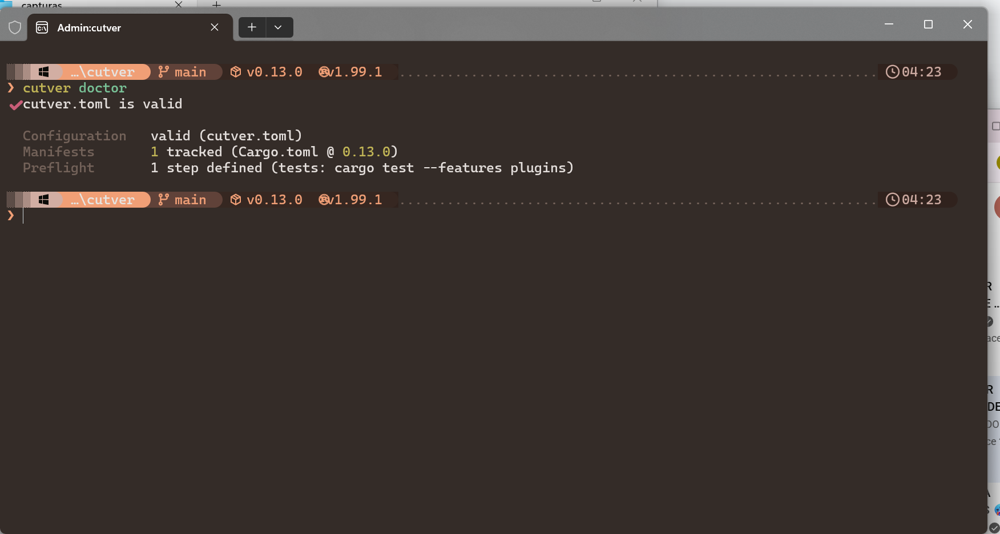
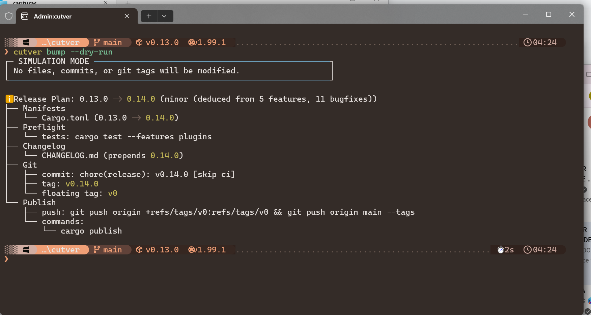
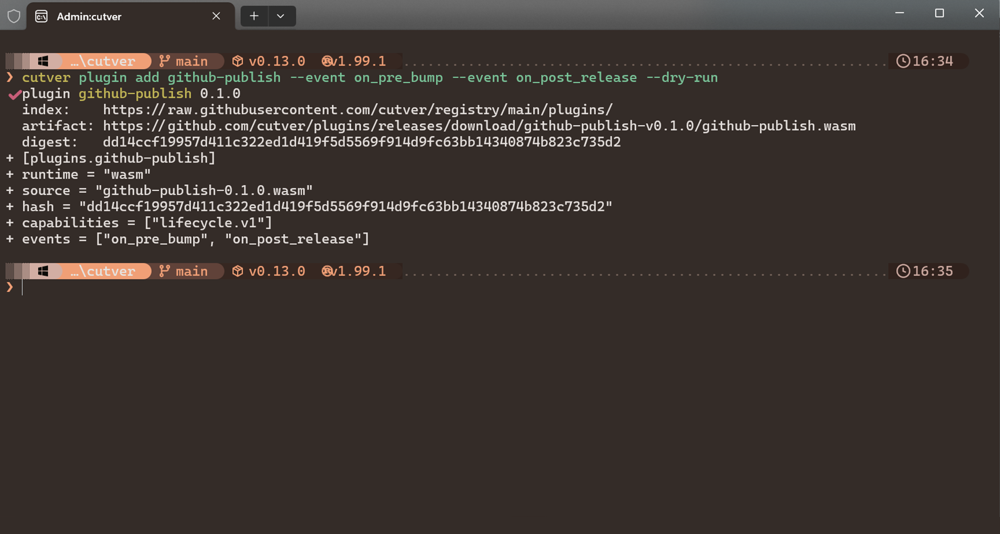
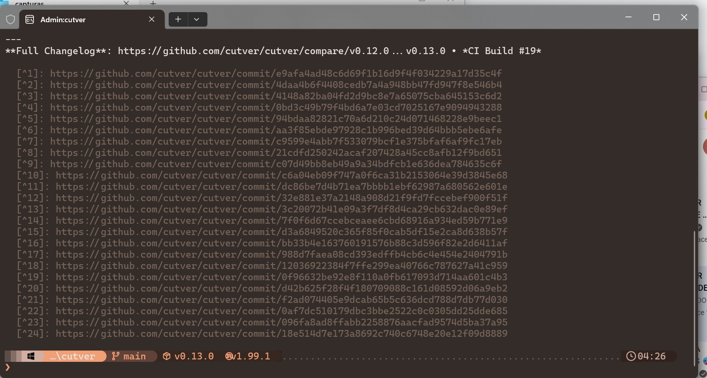

# Visual Tour

What cutver looks like at each step of the release lifecycle.

---

## Preflight Diagnostics — `cutver doctor`

Validating `cutver.toml`, tracking the primary manifest, and reporting preflight steps without anomalies.

  

---

## Atomic Bump Simulation — `cutver bump auto --dry-run`

The boxed SIMULATION MODE banner, SemVer deduction from conventional commits, and the hierarchical
tree of manifests, changelog, git tag, and `cargo publish`.

  

---

## WebAssembly Plugin Engine — `cutver plugin add`

Registry index resolution, wasm binary download URL, SHA-256 digest validation, and `cutver.toml`
injection — before and after the plugin is declared.

  

---

## Formatted Release Notes — `cutver changelog latest`

Generated release notes with conventional commit links, emojis for fixes and features, and the full
changelog diff.

  

---

## Related Documentation

- [Getting Started Walkthrough](getting-started.md): the same flow with copyable commands.
- [CLI Commands and Exit Codes](../reference/cli.md): every command shown here with its flags.
- [Installing and Managing Plugins](../reference/plugins.md): what `cutver plugin add` writes and verifies.
